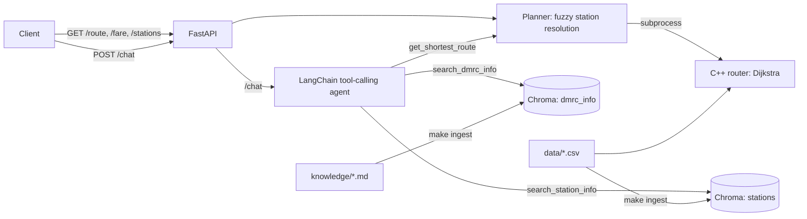

# Smart Commute Delhi

A Delhi Metro route planner in three layers:

1. **C++17 routing engine**: Dijkstra over a `(station, line)` graph of 250 stations, with explicit interchange
   cost, shortest-time and fewest-interchange modes, and an estimated fare.
2. **FastAPI service**: REST endpoints over the engine, with fuzzy station-name resolution.
3. **LangChain agent with RAG**: a chat endpoint where an OpenAI model decides, per question, whether to call the
   route engine, search DMRC rules, or look up station facts (ChromaDB).

The engine is the source of truth for routes, times and fares. The LLM never computes a route itself.

## Architecture



## Project layout

```
src/                  C++ engine (metro, router, CLI)
data/                 stations.csv, connections.csv (generated), source JSON
scripts/
  build_graph.py      generates the CSVs from the source JSON
  ingest_knowledge.py builds the ChromaDB collections
  benchmark.py        routing latency through the Python client
  eval_agent.py       tool-selection / route accuracy of the agent
api/
  main.py             FastAPI app and endpoints
  planner.py          resolves names, then calls the engine
  stations.py         fuzzy name resolution (rapidfuzz) and aliases
  metro_client.py     subprocess wrapper and output parser for build/metro
  network.py          station metadata loaded from the CSVs
  rag.py              chunking, embedding and retrieval (ChromaDB)
  tools.py            the three agent tools
  agent.py            create_agent wiring, system prompt, answer extraction
knowledge/            DMRC facts as markdown, with sources and check dates
eval/questions.json   labelled questions for the agent evaluation
tests/                pytest suite
patches/              optional patches (current DMRC fare slabs for the C++ engine)
```

## Quick start

Requirements: `g++` with C++17, Python 3.10+, and an OpenAI API key for `/chat` (the REST routing endpoints work
without one).

```bash
make                      # generate graph CSVs and build the C++ engine into build/metro
make install              # create .venv and install Python dependencies
cp .env.example .env      # then set OPENAI_API_KEY
make ingest               # embed the knowledge base and station documents into ChromaDB
make serve                # http://127.0.0.1:8000  (interactive docs at /docs)
```

Try it:

```bash
curl "http://127.0.0.1:8000/route?src=rithala&dst=huda%20city%20centre"
curl "http://127.0.0.1:8000/route?src=rajiv%20chowk&dst=dwarka&mode=least_interchange"
curl "http://127.0.0.1:8000/fare?src=AIIMS&dst=Noida%20City%20Centre"
curl "http://127.0.0.1:8000/stations?q=kashmiri%20gate"
curl -X POST http://127.0.0.1:8000/chat -H "Content-Type: application/json" \
     -d '{"message": "Fastest way from Rajiv Chowk to Dwarka, and how much luggage can I take?"}'
```

Docker (`/chat` needs the key and a prior ingest):

```bash
docker build -t smart-commute-delhi .
docker run --rm -p 8000:8000 --env-file .env -v "$PWD/.chroma:/app/.chroma" smart-commute-delhi
docker run --rm --env-file .env -v "$PWD/.chroma:/app/.chroma" smart-commute-delhi python scripts/ingest_knowledge.py
```

## API

| Endpoint | Description |
|----------|-------------|
| `GET /health` | Engine built? Station count, whether an OpenAI key is configured |
| `GET /stations?q=` | Fuzzy station search with match scores and lines |
| `GET /route?src=&dst=&mode=` | Route from the C++ engine. `mode` is `fastest` or `least_interchange` |
| `GET /fare?src=&dst=` | Estimated fare, station count and time |
| `POST /chat` | `{"message": "...", "history": [...]}` returns the answer and the tools the agent called |

Station names can be informal or misspelled. If a name is ambiguous the API returns `409` with candidates, and if
it is unknown it returns `404`. An auto-corrected typo is reported in the response under `corrections`.

## How the agent decides

`/chat` runs a LangChain tool-calling agent (`langchain.agents.create_agent`). On every turn the model receives the
question plus the schema and description of each tool and returns either an answer or a structured tool call. The
runtime executes the call, feeds the result back, and repeats until the model answers.

| Tool | Used for | Backed by |
|------|----------|-----------|
| `get_shortest_route` | Any "how do I get from A to B", time, interchanges, trip fare | C++ engine via the planner |
| `search_dmrc_info` | Fare slabs, smart card discounts, luggage, prohibited items, timings | ChromaDB `dmrc_info` |
| `search_station_info` | Lines at a station, interchanges, neighbouring stations, coordinates | ChromaDB `stations` |

A question can trigger several tools, for example a route plus a luggage rule. The tool descriptions state both
when to use a tool and when not to, which is what steers selection. Each step counts toward a recursion limit
(`AGENT_RECURSION_LIMIT`, default 12) so a confused agent cannot loop.

## Design decisions

- **The engine stays in C++ and is called as a subprocess.** It is stateless, needs no bindings, and starts in a
  few milliseconds because it only loads two small CSVs. The cost is one process spawn per request, which
  `scripts/benchmark.py` measures. A persistent worker or pybind11 would be the next step at higher load.
- **Station names are resolved in Python before the engine is called.** The CLI only accepts exact or unambiguous
  partial names. Resolution normalises text, applies a small alias table (for example Connaught Place maps to
  Rajiv Chowk), then fuzzy-matches with rapidfuzz. Near-ties return candidates for the user to choose from instead
  of guessing.
- **Routing facts never come from the LLM or from retrieval.** Paths, times and fares come only from the engine, so
  there are no stale or invented routes. Retrieval covers text facts that do not fit the graph.
- **Two collections, two tools.** Policy text and station facts have different shapes, and separate tools with
  explicit "do not use for" lines reduce mis-routing.
- **Station documents are generated from the same CSVs the engine reads.** There is one source of truth.
- **The knowledge base is plain markdown with sources and check dates**, chunked on headings first, so every claim
  is traceable and easy to update.

## Testing and evaluation

```bash
make test          # unit and integration tests (no OpenAI key needed)
make benchmark     # routing latency over random station pairs: p50 / p95 / p99
make eval          # agent tool-selection and route accuracy on eval/questions.json (needs OPENAI_API_KEY)
```

The tests use a deterministic fake embedding model and a scripted chat model, so the real agent loop, tools,
retrieval plumbing and API run offline. `scripts/eval_agent.py` runs the real model on `eval/questions.json` and
prints tool accuracy, route accuracy and latency from your own run.

## Limitations

- The engine's fare is an estimate: it assumes about 1.2 km per hop and uses distance slabs. Those slabs predate
  DMRC's 25 August 2025 revision, while `knowledge/dmrc_fares_and_cards.md` lists the current official fares. The
  agent is told to label route fares as estimates.
- `knowledge/` is written from public reporting and third-party pages, not DMRC data feeds. Check dates are in each
  file, and anything time-sensitive (fares, timings, luggage limits) should be re-verified before you rely on it.
- Station facilities (lifts, parking, gates) are not in the data, so the agent cannot answer them.
- No live data: no real-time train status or delays.
- No authentication or rate limiting on the API.

## C++ command-line router

The original terminal interface still works:

```bash
make
./build/metro
```

```
metro> stations rajiv
metro> info Kashmere Gate
metro> route Rithala to Huda City Centre
metro> route rajiv to dwarka least
metro> fare AIIMS to Noida City Centre
metro> lines
metro> quit
```

- Shortest-time route (default) with a 5-minute interchange penalty
- Fewest-interchange route (`least`)
- Station search, line listing, estimated DMRC fare slabs
- No network calls: everything is local CSV generated from public station and edge data

Each hop is an undirected edge on a metro line (about 2.2 minutes). At interchange stations the graph adds a
5-minute edge between the two lines, and Dijkstra minimises either minutes or interchange count. If a station query
matches more than one station, the CLI lists them instead of guessing.

Station coordinates and connectivity come from
[biomathcode/delhi-metro-react](https://github.com/biomathcode/delhi-metro-react) (`stations-lite.json`,
`edge.json`). Regenerate the CSVs with `python3 scripts/build_graph.py`.

## License

MIT. See `LICENSE`.
